# 🛒 E-Commerce Platform (Brand Store)

A full-stack e-commerce application built with **Ruby on Rails**. It features a customer-facing storefront with intelligent product recommendations, a secure checkout flow, and a comprehensive administrative dashboard powered by **custom, from-scratch pure Ruby algorithms** for customer segmentation and market basket analysis.

---

## 🚀 Live Demo & Credentials

**Live Application:** [https://brand-store-xrka.onrender.com/](https://brand-store-xrka.onrender.com/)

> ⚠️ **Note:** The application is hosted on Render's free tier. The first time you visit, the server may need to "wake up" (cold boot), which can take 1–2 minutes. Please be patient if the initial load seems slow!

### 🔑 Test Credentials

| Role | Email | Password | Access Level |
| :--- | :--- | :--- | :--- |
| **Admin** | `admin@example.com` | `Admin@123` | Full access to Dashboard, Analytics, and Algorithmic Tools |

---

## 🛠 Tech Stack

| Layer | Technology |
| :--- | :--- |
| **Backend Framework** | Ruby on Rails 7+ |
| **Frontend** | Hotwire (Turbo Streams, Stimulus), ERB |
| **Database** | PostgreSQL |
| **Authentication** | Devise (Custom Controllers) |
| **Payments** | Stripe Checkout API |
| **Algorithms / ML** | **Custom Pure Ruby Implementations** (K-Means, Apriori, Collaborative Filtering) |
| **File Storage** | ActiveStorage |

---

## 🏗 Architecture Overview

The application is logically divided into distinct architectural modules based on the `routes.rb` configuration, maintaining a strict separation of concerns:

1. **Storefront (`Storefront::` namespace)**: Customer-facing routes with clean URLs for browsing, cart management, and checkout.
2. **Dashboard (`Dashboard::` namespace)**: Administrative backend with `/dashboard` prefixed URLs for catalog, order, and customer management.
3. **Authentication (`Users::` namespace)**: Custom Devise controllers handling secure registration, login, and guest-to-user cart merging.
4. **Payments & System**: Dedicated endpoints for payment gateway callbacks and infrastructure health checks.

---

# 📖 Module Documentation

## 🛍 1. Storefront Module
*The customer-facing e-commerce interface, handling product browsing, intelligent recommendations, cart management, secure checkout flows, and user account dashboards.*

### 1.1 Catalog & Browsing
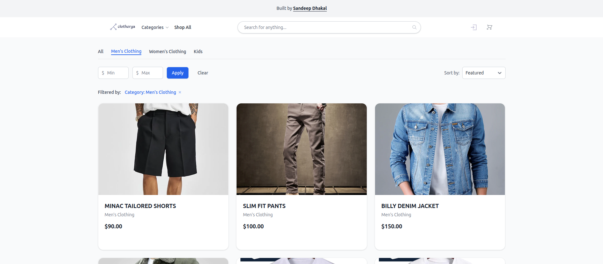

**Routes:** `GET /`, `GET /shop`, `GET /shop/products/:id`, `GET /shop/collections/:handle`, `GET /products`, `GET /categories`, `GET /about`, `GET /privacy`, `GET /terms`, `GET /contact`

| Requirement | Status | Implementation |
|---|:---:|---|
| Display featured products and categories | ✅ | `Storefront::LandingPageController#index` fetches limited sets of categories and products for the homepage. |
| Browse products with filtering and sorting | ✅ | `Storefront::ProductsController#index` and `CategoriesController#show` support filtering by `category_id`, `min_price`, `max_price`, and sorting by price or name. |
| View detailed product page with recommendations | ✅ | `Storefront::ProductsController#show` loads product details, variants, and fetches recommendations via `ItemBasedRecommendationService` with a popularity fallback. |
| Track user interactions for algorithmic features | ✅ | `UserInteraction.create!` is triggered on product views (score: 1.0) and add-to-cart actions (score: 2.0) for authenticated users. |
| View static informational pages | ✅ | `Storefront::PagesController` handles clean URLs for `/about`, `/privacy`, `/terms`, and `/contact`. |

**Implementation Details:**
- **Efficient SQL Aggregation**: Filtering and sorting are handled at the database level using `joins(:variants)`, `group("products.id")`, and `order("min_variant_price ASC/DESC")`.
- **Clean URL Scoping**: By using `scope module: :storefront` in `routes.rb`, URLs remain clean and SEO-friendly (e.g., `/shop/products/123`), while the code remains neatly organized under the `Storefront::` namespace.

---

### 1.2 Cart & Checkout Flow
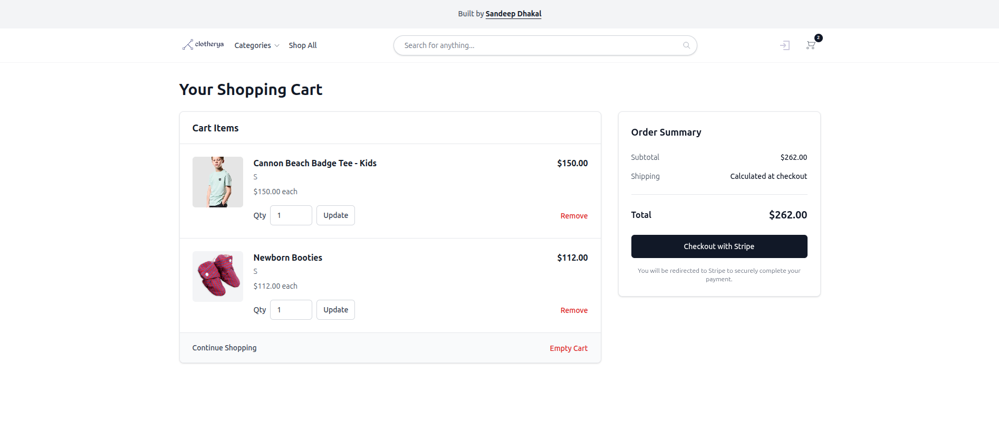
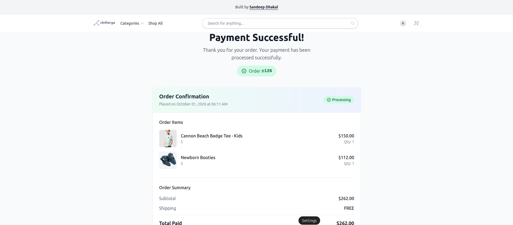

**Routes:** `GET /cart`, `PATCH/PUT /cart`, `DELETE /cart`, `POST /cart_items`, `PATCH/PUT /cart_items/:id`, `DELETE /cart_items/:id`, `GET /checkout/show`, `POST /checkout/create`, `GET /checkout/success`, `GET /checkout/cancel`, `POST /orders`, `GET /orders/:id`, `GET /orders/:id/success`, `GET /orders/:id/cancel`

| Requirement | Status | Implementation |
|---|:---:|---|
| Add, update, or remove items from cart | ✅ | `Storefront::CartItemsController` handles `create`, `update`, and `destroy` actions, validating variant existence and quantity limits. |
| View and clear entire cart | ✅ | `Storefront::CartsController` provides `show` and `destroy` actions to display or empty the cart. |
| Initiate secure checkout | ✅ | `Storefront::OrdersController#create` generates a Stripe Checkout Session with line items, metadata, and shipping address collection. |
| Handle payment success and stock deduction | ✅ | `Storefront::OrdersController#success` verifies the Stripe session, deducts inventory, creates order items, and clears the cart atomically. |
| Handle payment cancellation | ✅ | `Storefront::OrdersController#cancel` redirects the user back to the cart with an informative alert, leaving the order in a "pending" state. |

**Implementation Details:**
- **Strict Session Validation**: The `success` action retrieves the `Stripe::Checkout::Session` and explicitly verifies that the `session.id`, `metadata["order_id"]`, and `metadata["user_id"]` perfectly match the current user and order, preventing malicious URL tampering.
- **Atomic Transaction Block**: Order fulfillment is wrapped in `ActiveRecord::Base.transaction`. If stock deduction, order item creation, or cart clearing fails, the entire operation rolls back.

---

### 1.3 User Dashboard
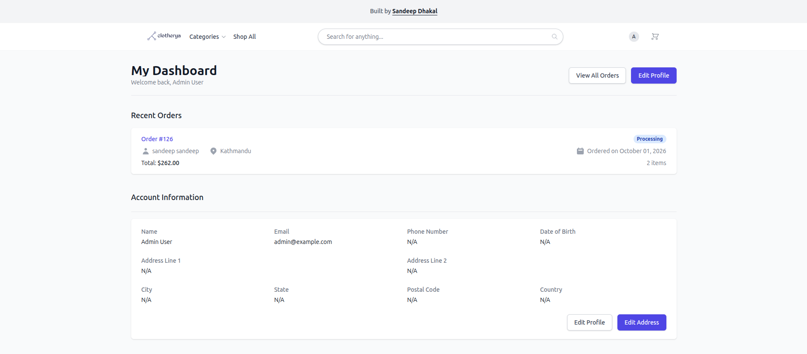

**Routes:** `GET /user_dashboard`, `GET /user_dashboard/orders`, `GET /user_dashboard/orders/:id`, `GET /user_dashboard/profile`, `GET /user_dashboard/profile/edit`, `PATCH/PUT /user_dashboard/profile`, `GET /user_dashboard/address`, `GET /user_dashboard/address/edit`, `PATCH/PUT /user_dashboard/address`

| Requirement | Status | Implementation |
|---|:---:|---|
| View account overview with recent activity | ✅ | `Storefront::UserDashboardsController#show` loads the current user and their 5 most recent orders. |
| View order history and detailed receipts | ✅ | `Storefront::UserDashboard::OrdersController` (index, show) lists and displays details of orders belonging to the `current_user`. |
| Manage user profile and shipping addresses | ✅ | Nested resources under `resource :user_dashboard` route to dedicated profile and address controllers for `show`, `edit`, and `update` actions. |

**Implementation Details:**
- **Nested Resource Routing**: The routes are elegantly nested under `resource :user_dashboard`, creating intuitive, RESTful paths while keeping controllers logically grouped in `app/controllers/storefront/user_dashboard/`.
- **Strict Ownership Scoping**: All dashboard routes are protected by `before_action :authenticate_user!`. Queries explicitly scope to `current_user.orders`, preventing ID manipulation.

---

## 📊 2. Dashboard (Admin) Module
*The administrative backend, providing comprehensive tools for catalog management, order fulfillment, customer segmentation, and business analytics.*

### 2.1 Overview & Analytics
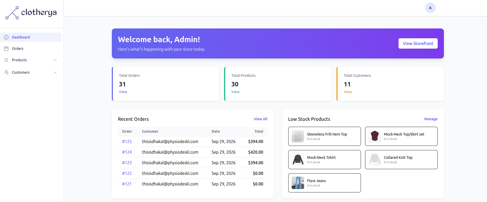

**Routes:** `GET /dashboard`, `GET /dashboard/reports`

| Requirement | Status | Implementation |
|---|:---:|---|
| Display high-level business metrics | ✅ | `Dashboard::LandingPageController#index` aggregates total orders, products, users, and revenue. |
| Identify operational bottlenecks | ✅ | Fetches `@low_stock_products` (threshold ≤ 5) and `@recent_orders` for immediate admin action. |
| Generate date-range financial reports | ✅ | `Dashboard::ReportsController#index` calculates total sales, average order value, and top-selling products within a customizable date range. |

---

### 2.2 Catalog Management
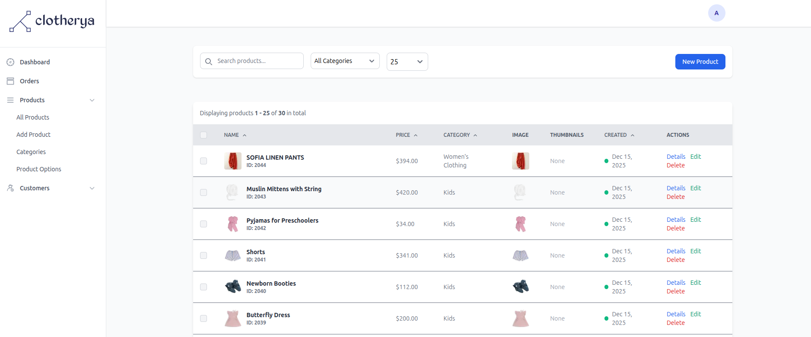
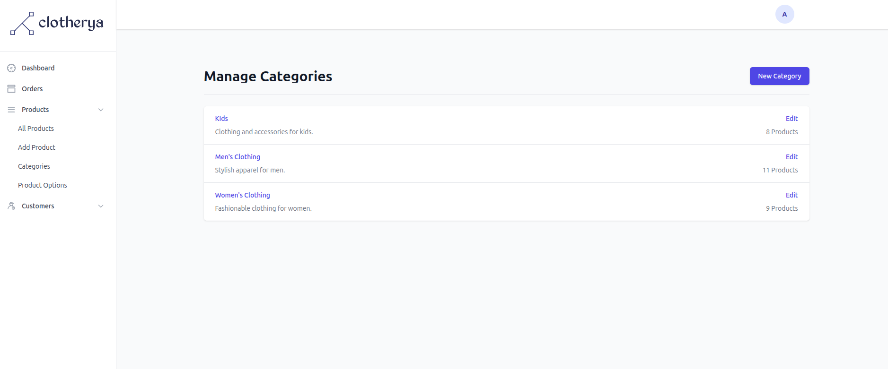
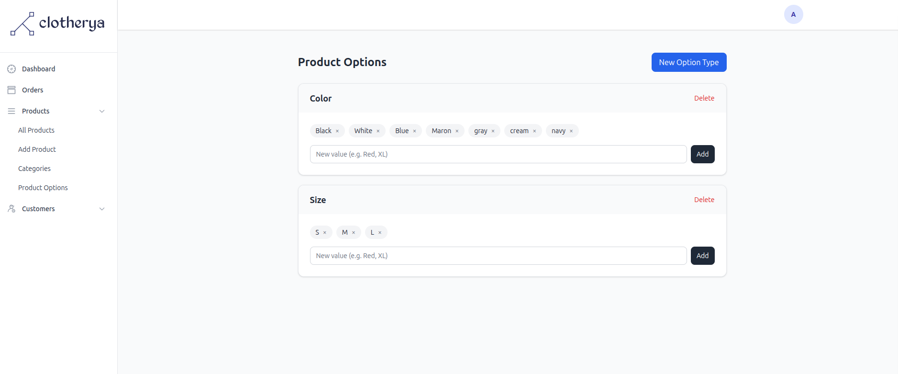

**Routes:** `GET/POST/PUT/DELETE /dashboard/products`, `POST /dashboard/products/bulk_action`, `GET/POST/PUT/DELETE /dashboard/categories`, `GET/POST/PUT/DELETE /dashboard/collections`, `POST /dashboard/collections/preview`, `GET/POST/DELETE /dashboard/option_types`, `GET/POST/DELETE /dashboard/option_types/:option_type_id/option_values`

| Requirement | Status | Implementation |
|---|:---:|---|
| Full CRUD for Products with variants | ✅ | `Dashboard::ProductsController` handles nested attributes (`variants_attributes`) for creating/updating products and their variants in a single transaction. |
| Category management with deletion guards | ✅ | `Dashboard::CategoriesController` prevents deletion of categories that still have associated products, preserving data integrity. |
| Dynamic, rule-based Smart Collections | ✅ | `Dashboard::CollectionsController` allows defining rules. The `preview` action dynamically evaluates these rules against the product database. |
| Seamless Option/Variant management | ✅ | `Dashboard::OptionTypesController` and `OptionValuesController` utilize Turbo Streams for instant, partial-page updates. |

---

### 2.3 Order & Customer Management
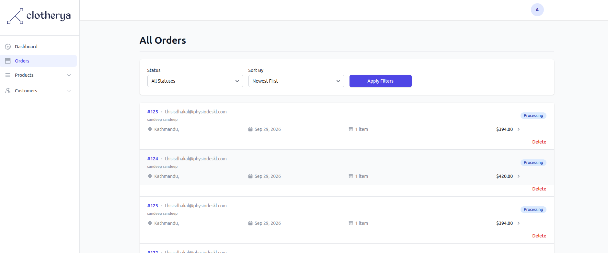
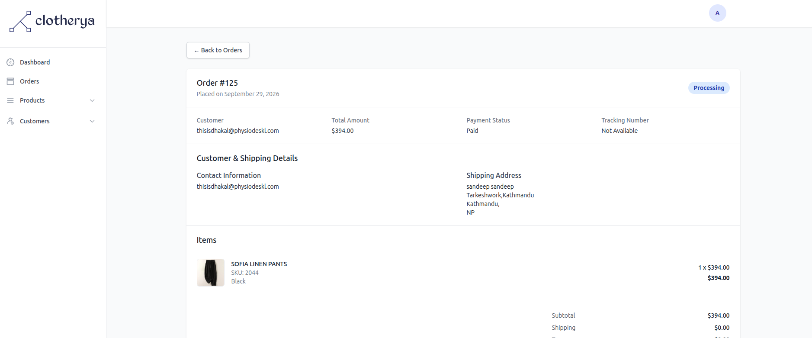
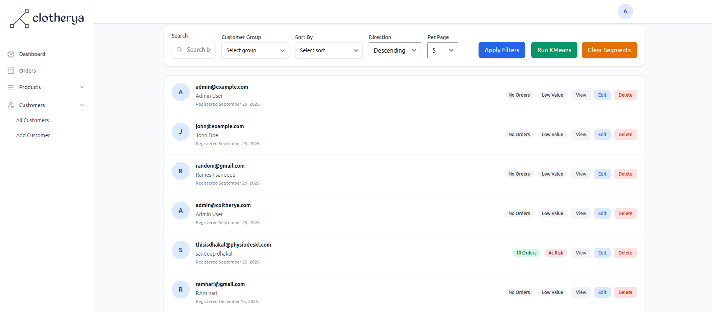

**Routes:** `GET/POST/PUT/DELETE /dashboard/orders`, `GET/POST/PUT/DELETE /dashboard/users`, `POST /dashboard/users/run_kmeans`, `POST /dashboard/users/clear_customer_groups`, `GET /dashboard/customer_groups`, `GET/POST/PUT/DELETE /dashboard/user_interactions`

| Requirement | Status | Implementation |
|---|:---:|---|
| View and filter all customer orders | ✅ | `Dashboard::OrdersController#index` supports filtering by `status` and sorting by date or ID, with Kaminari pagination. |
| Execute algorithmic customer clustering | ✅ | `Dashboard::UsersController#run_kmeans` triggers the custom `KMeansSegmenter` service to group users based on spending and order frequency. |
| View and manage raw interaction data | ✅ | `Dashboard::UserInteractionsController` allows admins to view, search, and manually curate `UserInteraction` records. |

**Implementation Details:**
- **From-Scratch Pure Ruby Algorithms**: The K-Means clustering, Apriori market basket analysis, and Collaborative Filtering logic are written entirely in pure Ruby from scratch. This avoids heavy external dependencies (like Python microservices or large ML gems), keeping the architecture lightweight, self-contained, and highly customizable.
- **Dynamic SQL Aggregation**: Sorting users by `orders_count` dynamically left-joins the `orders` table and uses `Arel.sql("COUNT(orders.id) #{sort_order.upcase}")` to sort users by purchase frequency without requiring denormalized counter cache columns.

---

## 🔐 3. Authentication Module (Devise)
*The secure authentication and session management layer, customized to handle role-based access, seamless guest-to-user transitions, and strict parameter sanitization.*

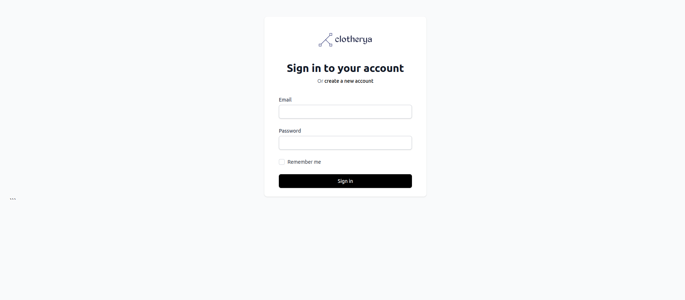

**Routes:** `GET/POST /users/sign_in`, `DELETE /users/sign_out`, `GET/POST /users/sign_up`, `GET/PUT /users/edit`

| Requirement | Status | Implementation |
|---|:---:|---|
| Secure user registration with specific fields | ✅ | `Users::RegistrationsController` overrides `sign_up_params` to permit `first_name`, `last_name`, `email`, and password fields. |
| Enforce default user role on sign-up | ✅ | The `sign_up_params` method explicitly merges `role: :customer`, preventing privilege escalation during public registration. |
| Seamless guest-to-user cart transition | ✅ | `Users::SessionsController#after_sign_in_path_for` intercepts the login flow to find the `session[:cart_id]` and reassigns it to the authenticated user. |
| Role-based post-login redirection | ✅ | Dynamically routes `admin` users to `dashboard_root_path` and `customer` users to `user_dashboard_path`. |

**Implementation Details:**
- **Post-Login Hook**: The `after_sign_in_path_for` callback is the perfect interception point for cart merging. It executes *after* the user is successfully authenticated but *before* the HTTP redirect occurs.
- **Safe Navigation**: The code uses the safe navigation operator (`guest_cart&.user_id.nil?`) to prevent `NoMethodError` exceptions if the session points to a deleted cart.

---

## 💳 4. Payments Module
*Dedicated endpoints for handling payment gateway initialization and asynchronous callback verification.*

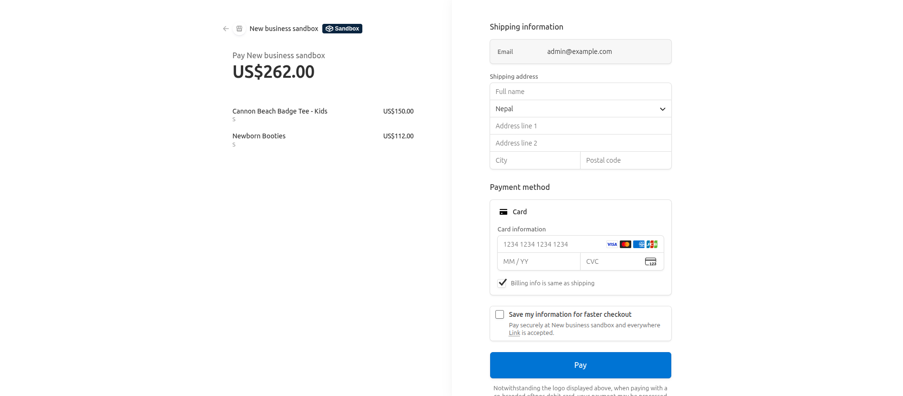

**Routes:** `GET /payments`, `POST /payments/pay`, `POST /payments/esewa/success`, `POST /payments/esewa/failure`

| Requirement | Status | Implementation |
|---|:---:|---|
| Initialize payment gateway | ✅ | `PaymentsController#pay` prepares the transaction payload and redirects the user to the external payment provider. |
| Handle successful payment callbacks | ✅ | `PaymentsController#success` processes the callback from the payment provider, updating the associated order status to "paid". |
| Handle failed payment callbacks | ✅ | `PaymentsController#failure` logs the failure reason and updates the order status, allowing the user to retry. |

---

## 🌐 5. Public & System Routes
*Standalone top-level routes and infrastructure endpoints.*

**Routes:** `GET /search`, `GET /placeholder`, `POST /contact`, `GET /up`, `ALL /rails/active_storage/*`

| Requirement | Status | Implementation |
|---|:---:|---|
| Global site search | ✅ | `SearchController#show` handles search queries across products and categories. |
| General contact form submission | ✅ | `ContactMessagesController#create` validates and saves inbound customer inquiries. |
| Infrastructure health checks | ✅ | `GET /up` routes to `rails/health#show` for load balancer and uptime monitoring (e.g., Render.com). |
| File and image serving | ✅ | `ActiveStorage::Engine` is mounted at `/rails/active_storage` to handle product images and attachments. |

---

## 🔮 Future Roadmap & Improvements

Given the scope and time budget, core features were prioritized for stability. With more time, the following enhancements would be implemented:

1. **Stripe Webhook Integration**: Relying solely on the redirect `success` URL is fragile. Implementing a Stripe Webhook endpoint would guarantee order fulfillment even if the client disconnects before the redirect completes.
2. **Background Job for Algorithms**: Running `KMeansSegmenter` or `AprioriService` synchronously in the controller will timeout or block web workers as the dataset grows. This should be moved to a background job (e.g., Sidekiq) with a progress indicator.
3. **Soft Deletes for Critical Entities**: Implement `acts_as_paranoid` or a custom `deleted_at` timestamp for `User` and `Order` models. Hard deleting users can orphan historical analytics, and soft deletes provide a safer "trash bin" recovery mechanism.
4. **Advanced Cart Merging**: Instead of a simple "takeover" of the guest cart, implement a true merge. If a user already has items in their database cart *and* a guest cart, the system should combine the line items, summing the quantities of matching variants.
5. **Algorithmic Result Caching**: Cache the results of `ItemBasedRecommendationService` and `AprioriService` using Redis or Rails cache, keyed by `product_id`, to reduce database load and latency on high-traffic product pages.